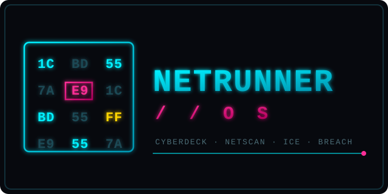

<p align="center">
  
</p>

# NETRUNNER//OS

A Cyberpunk 2077-style **netrunner suite** for Omarchy — fully functional, not a mockup.
Every panel is backed by real system data (`psutil`, `ip -j`, `nmcli`, ARP tables,
`systemctl`, `journalctl`, threaded ICMP/TCP scans).

Built for **TITAN** (Arasaka Security deck) — but runs on any Linux box with Python 3.11+.

```
███╗   ██╗███████╗████████╗██████╗ ██╗   ██╗███╗   ██╗███╗   ██╗███████╗██████╗
████╗  ██║██╔════╝╚══██╔══╝██╔══██╗██║   ██║████╗  ██║████╗  ██║██╔════╝██╔══██╗
██╔██╗ ██║█████╗     ██║   ██████╔╝██║   ██║██╔██╗ ██║██╔██╗ ██║█████╗  ██████╔╝
██║╚██╗██║██╔══╝     ██║   ██╔══██╗██║   ██║██║╚██╗██║██║╚██╗██║██╔══╝  ██╔══██╗
██║ ╚████║███████╗   ██║   ██║  ██║╚██████╔╝██║ ╚████║██║ ╚████║███████╗██║  ██║
╚═╝  ╚═══╝╚══════╝   ╚═╝   ╚═╝  ╚═╝ ╚═════╝ ╚═╝  ╚═══╝╚═╝  ╚═══╝╚══════╝╚═╝  ╚═╝  //OS
```

## The suite — CP2077 concept → real implementation

| Cyberpunk concept | Module | What it actually does |
|---|---|---|
| Cyberdeck status | `dashboard` | per-core CPU, RAM, swap, disk, temps (acpitz/nvme), clock, load, uptime, GPU |
| Net access | `netscan` | interfaces via `ip -j`, default route, DNS, nmcli, ARP table, threaded 254-host ping sweep |
| ICE | `ice` | firewall probe (firewalld/ufw/nftables), all LISTEN sockets with owning processes, ICE strength rating on the Cyberpunk tier scale (White → Violet): firewall state and network-facing listeners; loopback-only sockets don't count |
| Daemons | `daemons` | systemd roster (system + user), failed units, top processes |
| Data shards | `shards` | journalctl entries parsed as shards with severity colors + a personal shard vault (`~/.netrunner/shards/`) |
| Breach Protocol | `breach` | the actual 6×8 byte-buffer minigame: faithful row tables (2/3/3+4/3+4/5/5-byte sequences), cyan data / magenta malware / yellow maelstrom bytes, cursor movement, sequence execution, completion |
| Quickhacks | `hack` | ping, traceroute, DNS decrypt (dig/getaddrinfo), threaded TCP port scan (42 common ports), HTTP inspect |
| **Armory (damage)** | `armory` | **executes** real actions: kill processes (Downtime), sever TCP sockets via `ss -K` (Short Circuit), Wake-on-LAN, systemctl control, ssh exec, ping flood, reboot/suspend the deck — every action gated behind `--yes`/confirm and recorded in `~/.netrunner/actions.jsonl` |
| Fixer (AI) | `edgerunner` / `ask` | a nameable AI fixer backed by a **local** Halogen/OpenAI-compatible server; answers net/Linux/Omarchy questions with a live snapshot of your deck as context |

## Usage

```bash
netrunner                    # interactive TUI (8 tabs, live refresh)
netrunner boot               # animated cold-boot sequence (built from live data)
netrunner status             # one-shot cyberdeck readout
netrunner scan               # netscan incl. live ping sweep of your /24
netrunner scan --no-sweep    # interfaces + ARP + nmcli only
netrunner ice                # ICE analysis + listening sockets
netrunner daemons [--all]    # systemd roster
netrunner shards [-n N]      # journal as data shards
netrunner shard "Title" "body"   # store a shard in your vault
netrunner hack ping 1.1.1.1  # quickhacks: ping | trace | dns | ports | http
netrunner hack ports host --ports 22,80,443
# ARMORY — the damage half (all actions need -y/--yes and land in the action log)
netrunner kill 1234          # DOWNTIME: signal a process (pid or name, -s KILL, -f)
netrunner cut 192.168.1.50   # SHORT CIRCUIT: sever TCP connections to a host (--port N)
netrunner wake aabb.ccdd.eeff  # Wake-on-LAN magic packet (--via broadcast addr)
netrunner svc restart cups.service        # daemon control (--user for user units)
netrunner ssh host uptime    # remote exec (BatchMode, never hangs on password; -y to skip confirm)
netrunner flood host -c 64   # ping flood (ping -f w/ root, -i 0.1 fallback)
netrunner reboot -y / suspend -y          # the deck itself
netrunner log                # audit trail: every executed, refused or failed quickhack
netrunner breach             # play Breach Protocol (WASD)
netrunner breach --demo --seed 42   # watch the deck auto-play
netrunner ask "why is my gateway unreachable?"   # one-shot EDGERUNNER query
netrunner edgerunner         # interactive chat with your fixer
netrunner config --operator V --corp ARASAKA --deck TITAN
netrunner config --fixer "Johnny Silverhand"      # name your AI fixer
netrunner config --fixer-url http://192.168.1.20:8080  # point it at your server
```

### TUI keys
- `1`–`8` switch tabs (Dashboard / Netscan / ICE / Daemons / Shards / Breach / Edgerunner / Armory)
- arrows or `WASD` drive the Breach Protocol cursor
- `n` starts a new protocol · `q` jacks out
- on the Edgerunner tab, type a question and hit `Enter` to consult your fixer

## Running as root

NETRUNNER//OS is a **per-user** deck and refuses to launch under `sudo`
(`NETRUNNER_ALLOW_ROOT=1` overrides). The few probes that need privileges —
firewall/ICE status via `ufw`/`nft`/`firewalld` — escalate *themselves* per
command with `sudo -n`, so the whole app never has to run as root. When a
backend is present but unreadable without privileges, ICE reports it as
`UNKNOWN` rather than falsely claiming the net is wide open.

## Omarchy application

`install.sh` adds an XDG desktop entry (`~/.local/share/applications/NETRUNNER.desktop`)
so the deck shows up in the Omarchy app launcher and opens tiled in a terminal
via `xdg-terminal-exec --app-id=TUI.tile`, with its own icon
(`~/.local/share/icons/hicolor/scalable/apps/netrunner.svg`). Without
`xdg-terminal-exec` it falls back to a standard terminal launcher.

## EDGERUNNER — the AI fixer

`edgerunner` / `ask` talk to a **local** OpenAI-compatible inference server
(default `http://localhost:8080`; llama.cpp, LM Studio, Ollama, vLLM or Halogen all work)
— nothing leaves the LAN.
The model id is auto-detected from `/v1/models` (override with
`--fixer-model`). Each query carries a compact live snapshot of the deck
(interfaces, route, DNS, firewall state) so the fixer can reason about *your*
network; pass `--no-context` to skip it. Name the fixer whatever you like with
`config --fixer`; the endpoint can also be overridden per-run with
`NETRUNNER_EDGERUNNER_URL` / `NETRUNNER_EDGERUNNER_NAME`.

## Architecture

```
netrunner/
├── cli.py        argparse front-end (every module reachable without the TUI)
├── ui.py         Textual app: TabbedContent + auto-refresh panes + breach key routing
├── banner.py     ASCII banner + boot sequence (generated from live interfaces/route)
├── palette.py    cyberdeck color system + gauge/bar primitives + ICE tiers
├── config.py     ~/.netrunner/config.toml (operator, corp, deck)
├── sysinfo.py    psutil vitals, top processes, GPU probe
├── netinfo.py    ip/nmcli/ARP parsing, ping sweep, traceroute, DNS, TCP scan, HTTP
├── ice.py        firewall probe, listening sockets, ICE tier assessment
├── daemons.py    systemctl parsing
├── shards.py     journalctl → shards (handles byte-array + list MESSAGE encodings)
├── breach.py     pure, testable game engine + CLI play/demo front-ends
└── edgerunner.py local AI fixer client (urllib → /v1/chat/completions)
```

Design rules followed:
- **Rich 15-safe rendering** — all dynamic text built via `Text.append(style=...)`,
  never markup strings, so log lines containing `[UFW BLOCK]` can't crash the renderer.
- **Engine/UI split** — `breach.py` is pure logic (seeded, testable); the TUI and CLI
  are thin front-ends over it.
- **Graceless environments tolerated** — every probe degrades: no dig → getaddrinfo,
  no firewalld → ufw → nftables, ufw needs root → "UNKNOWN, ICE presumed".

## Install

```bash
git clone https://github.com/vonhex/netrunner.git ~/Work/netrunner
~/Work/netrunner/install.sh
```

`install.sh` creates `.venv` (with `uv` if you have it, else `python3 -m venv`), links
`~/.local/bin/netrunner`, and adds the launcher and icon. Run it again after `git pull` to update.
Needs Python 3.11+.

## Tests

```bash
.venv/bin/python -m unittest discover -s tests -p "test_*.py"   # regression tests, pure logic
.venv/bin/python tests/smoke_test.py                               # headless TUI + breach engine
```
The regression tests need no root or network. The smoke test (`app.run_test`) mounts all
8 tabs, switches between them, drives the breach game with simulated arrow keys, and runs
5 seeded engine round-trips (generate → complete → render). Both run on every push and pull
request via GitHub Actions.

## License

[PolyForm Noncommercial License 1.0.0](LICENSE). **Free to use, copy and modify for any
non-commercial purpose**: personal use, hobby projects, research, charities, schools and public
bodies. **Not for sale and not for commercial use**: you may not sell NETRUNNER//OS, charge for it,
or use it in or for a paid product or service. It's provided as is, with no warranty.

Only use the armory and scanning quickhacks on machines and networks you own or are allowed to
test.
